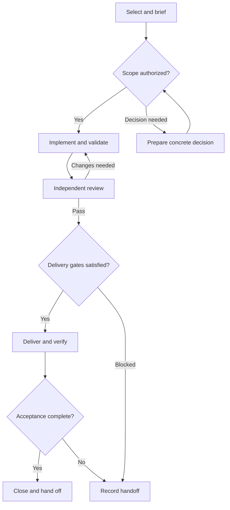

# Agent Delivery Playbook

**A reusable operating method for humans and AI agents, from task selection to verified delivery and handoff.**

Use this playbook to make work understandable, bounded, reviewable, and easy to resume. It covers project instructions, task organization, commencement, ownership, implementation, review, delivery, and handoff. It suits application development, libraries, documentation, data work, and infrastructure through project-specific settings and optional operational controls.

The playbook is Markdown and GitHub templates. It does not run agents, select models, deploy services, or enforce repository permissions. Humans can follow the same process without agent tools.

## Start here

1. Read [the operating method](docs/operating-method.md).
2. Adopt the files using [the adoption guide](docs/adoption.md), preserving existing project instructions.
3. Fill in [PROJECT.md](PROJECT.md): commands, scope, task store, owners, review policy, and delivery effects.
4. Create one task from [the task template](templates/task.md), link it in [the roadmap](tasks/roadmap.md), and present its outcome and acceptance checks.
5. Give a clear instruction such as **“Implement T-001 within the briefed scope.”** The worker continues through authorized steps and records a restartable handoff.

For a quick orientation, say **“Begin.”** For a recommendation and brief, say **“Next task.”** See [all commencement rules](docs/session-start.md).

## The workflow

The diagram summarizes the method. The [review policy](docs/review-protocol.md) defines proportionate review and the additional final verifier for high-impact changes. A review verdict and permission to act are separate records. Existing authorization remains valid within its scope; routine covered steps do not need repeated confirmation.

## What belongs where

| Path | Purpose |
| --- | --- |
| [AGENTS.md](AGENTS.md) | Short entrypoint for agents and universal working rules |
| [PROJECT.md](PROJECT.md) | Settings and facts for the adopting project |
| [docs/operating-method.md](docs/operating-method.md) | Scope, lifecycle, authorization, ownership, and completion |
| [docs/session-start.md](docs/session-start.md) | Begin, select, implement, resume, pause, and hand off |
| [docs/review-protocol.md](docs/review-protocol.md) | Review tiers, independence, verdicts, and evidence |
| [tasks/README.md](tasks/README.md) | Canonical task records and identifier conventions |
| [tasks/roadmap.md](tasks/roadmap.md) | Goals, priority, and links to tasks |
| [tasks/handoff.md](tasks/handoff.md) | Short index of current work |
| [tasks/findings.md](tasks/findings.md) | Cross-task findings and their dispositions |
| [templates](templates) | Task, review, handoff, decision, and operational checkpoint templates |
| [examples](examples) | Fictional examples for code and controlled external changes |
| [.github](.github) | Task request form and pull request template |

## Small core, proportionate controls

Start with a short task record and the checks needed to prove its outcome. Add checkpoints only when a task has separately controlled effects. [Operational changes](docs/operational-changes.md) add target identities, artifact freshness, recovery, and live verification where needed.

| Tier | Typical work | Review |
| --- | --- | --- |
| Light | Wording or presentation with no changed behavior or rules | Fresh reader; a disclosed self-check only when PROJECT.md explicitly permits it |
| Standard | Application behavior, APIs, dependencies, or substantive refactoring | Independent technical reviewer |
| High | Access, sensitive data, shared runtime/state, release controls, or governance rules | Independent technical reviewer and a distinct final verifier |

The same worker may coordinate and implement. Review independence depends on actual people or agent runs, not role names. No particular model, framework, cloud, editor, or tracker is required.

## Reuse on GitHub

Use **Use this template** for a new repository, or copy and adapt the files into an existing project. Keep the project’s README and merge its instructions deliberately. Template copies do not automatically receive later playbook updates; review upgrades like any other policy change.

Putting a link on a profile makes the playbook discoverable. Each adopting repository still needs its instructions installed or explicitly loaded by its tools. See the [GitHub integration notes](docs/adoption.md#github-placement).

## Contributing and license

See [CONTRIBUTING.md](CONTRIBUTING.md). Distributed under the [MIT License](LICENSE). The license covers this playbook; adopting it does not change the license of an existing project.
